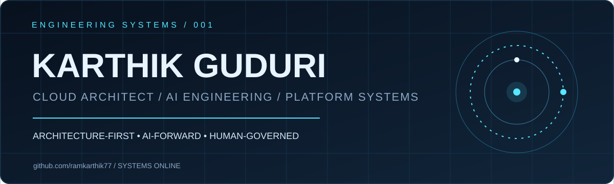
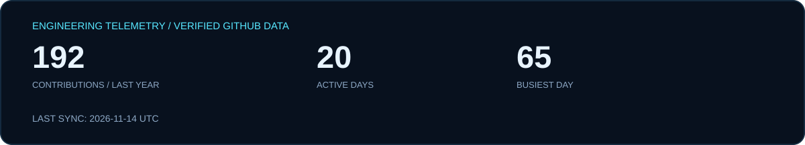
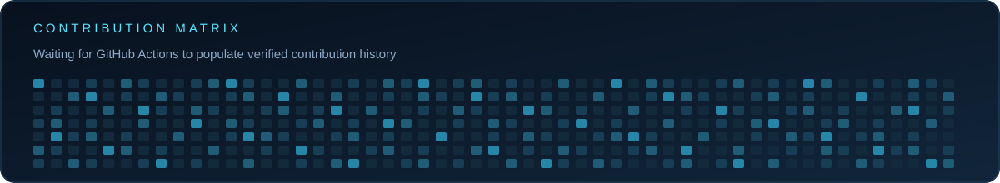
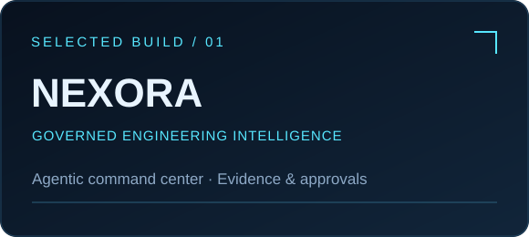
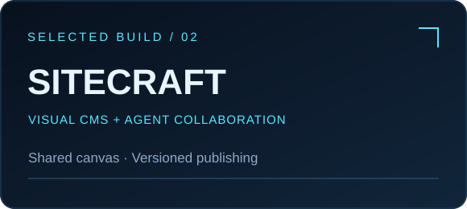
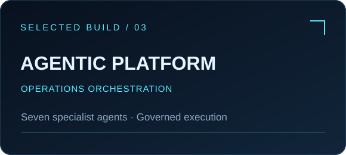
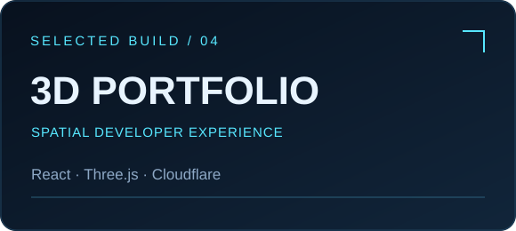

**ARCHITECTURE-FIRST · AI-FORWARD · HUMAN-GOVERNED**

Building cloud platforms, agentic engineering systems, and expressive developer experiences.

[**PORTFOLIO**](https://github.com/ramkarthik77/karthik-portfolio) · [**PROJECTS**](https://github.com/ramkarthik77?tab=repositories) · [**CONNECT**](https://github.com/ramkarthik77)

### 01 / Engineering signal

### 02 / Selected builds

<table>
<tr>
<td width="50%"></td>
<td width="50%"></td>
</tr><tr>
<td width="50%"></td>
<td width="50%"></td>
</tr>
</table>

### 03 / Technology I work with

`Adobe Experience Manager` · `AI Agents` · `Cloudflare Workers` · `TypeScript` · `React` · `Platform Engineering` · `Workflow Governance` · `Developer Experience`

> I build systems that make complex engineering work observable, explainable, and safely executable.

CRAFTED IN CODE · DYNAMIC STATS SYNC DAILY VIA GITHUB ACTIONS · @ramkarthik77

